## [PDF版完整教程](https://workdrive.zohopublic.com.cn/print/lycmy2fbd8e664397437fac078ac2f3ed990e)

## 准备

- 一台至少有 **6GB 机载运行内存** 的电脑，且有至少 **4GB 内存**可以分配给 Minecraft 使用（储存空间 > 5GB）
- 一个**正版 Minecraft 账号**（不支持离线版，更不支持网易；若没有，请至 XBOX 商店购买或订阅 XGP，即准备一个购买了正版 Minecraft 或拥有 XBOX Game Pass 订阅的微软账户）
- 下载好的根据需求选择的整合包（可能还有追加包）
- 一个懂得基础计算机知识的大脑

!!! info "关于手机进服"

    经测试，手机无法进入此服务器，请使用电脑游玩。

!!! info "关于电脑配置"

    作为参考，以 16 区块的渲染距离和模拟距离运行 10 分钟左右能吃满分配的 24GB 内存，原因在于此服务器使用的资源包内高分辨率贴图数量较多。

!!! tip "资源选择省流"

    如果不想看资源说明，请下载 **Clicktorun** 版本的整合包；如果硬盘空间足够建议下载 **Bobby 模组的追加包**，以获得更好的游玩体验。DistantHorizons 模组对 CPU 与存储空间要求较高，建议高配电脑尝试。

## 资源下载

提取码均为 `dEqH`，所有链接不限速、无需登录。

- 防丢短链（永久可访问，会自动重定向到当前可用的链接）：[https://rs.lpsguide.cn](https://rs.lpsguide.cn)
- 主链（Cloudreve——含全部资源，下载速度最快）：[https://pan.lnlfly.com/s/7eCq/dEqH](https://pan.lnlfly.com/s/7eCq/dEqH)
- 备用链 1（OneDrive——含全部资源，建议搭配多线程下载器使用）：[https://1drv.ms/f/c/959219da68d47a00/Eovu-Le5Y9JFtEgGSX10AwcBuAc7051FoGz_K9jf-qMHNA?e=p5DI3S](https://1drv.ms/f/c/959219da68d47a00/Eovu-Le5Y9JFtEgGSX10AwcBuAc7051FoGz_K9jf-qMHNA?e=p5DI3S)（大陆用户可能无法访问）
- 备用链 2（Zoho Workdrive——仅含 Basic、模组升级包与其他资源，下载速度快）：[https://workdrive.zohopublic.com.cn/external/e966604f12f757cfb97372be2dd6d1c22a2c8c53e79946e42252228266b8bb9a](https://workdrive.zohopublic.com.cn/external/e966604f12f757cfb97372be2dd6d1c22a2c8c53e79946e42252228266b8bb9a)

进入资源页面后，选择<kbd>整合包与追加包</kbd>。

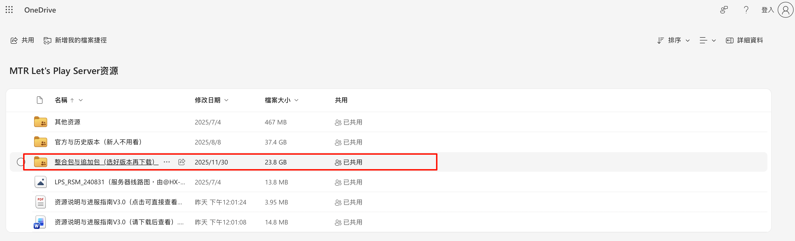

### 整合包版本说明

| 版本 | 说明 |
| --- | --- |
| **Basic** | 仅包含进入服务器所需的所有模组（附带一系列优化模组、一个光影包和 Slideshow 模组数据），打包体积小。如果觉得网盘下载速度慢，可以使用此版本，并在稍后启动游戏时通过模组自动下载资源包。不建议中国大陆地区用户下载此版本，官方资源包更新服务器位于海外，容易连接不上；镜像源下载速度较慢，只能作为备用 |
| **Clicktorun** | 包含模组和资源包，能快速进入服务器并获得完整体验（**推荐下载**）。之前的 Standard 与 Complete 版本不再分发，请通过自行添加追加包实现 |

整合包原分发方案对照如下（Standard 与 Complete 已弃用）：

| 版本 | 构成 |
| --- | --- |
| **Basic** | 模组 + Slideshow 数据 |
| **Clicktorun** | 模组 + Slideshow 数据 + 资源包 |
| **Standard**（已弃用） | 模组 + Slideshow 数据 + Xaero 全家桶数据 + 资源包 + Bobby 数据 |
| **Complete**（已弃用） | 模组 + Slideshow 数据 + Xaero 全家桶数据 + 资源包 + Bobby 数据 + DistantHorizons 数据 |

### 追加包说明

以下追加包包含模组本体、配置文件与模组数据，可以按需下载。其中 **Bobby** 与 **DistantHorizons** 两项是可选模组，如果您是第一次进服，请根据实际情况决定是否添加：

| 追加包 | 说明 |
| --- | --- |
| **Bobby模组与数据** | 将服务器区块以 `.mca` 格式缓存至本地，防止移动速度过快时（如乘坐高铁、飞机等）出现区块来不及加载而导致人物在虚空中运动的现象。目前 Bobby 数据已经覆盖了服务器内大部分热门线路，但在前往偏远的未缓存区域旅行时仍然可能会出现区块加载不及时的情况，第一次经过会自动进行缓存，以后再经过即可直接调用。推荐添加 |
| **DistantHorizons模组与数据** | 通过在默认视距之外添加简化过的地形（即区块的低精度模型），在尽量减小性能开销的情况下实现更远的视野距离，最高 4096 区块，模型通过 `.sqlite` 数据库存储。对 CPU 与存储空间要求较高，建议高配电脑尝试。需要注意的是，尽管 Bobby 也可以增加渲染距离且没有数值限制，但 Bobby 是正常加载完整区块，过高的视距可能导致游戏直接卡死崩溃 |
| **Slideshow模组与数据** | 用于显示服务器内的贴图，其数据是缓存到本地的贴图。提供给已安装整合包的用户进行更新 |
| **Xaero全家桶模组与数据** | 包含小地图和世界地图模组，支持路径点和大地图功能，其数据为缓存的小地图与世界地图数据。提供给已安装整合包的用户进行更新 |

!!! info "关于「MTR 4.0.0模组升级包」文件"

    此升级包包含进入服务器所需的所有模组（此文件为 `mods` 文件夹的压缩包，**不能作为整合包导入**，且不含 Bobby 与 DistantHorizons 两个模组），提供给以下用户进行快捷的模组替换或添加操作：因为没有及时更新模组导致无法进入服务器的用户（最常见）、从之前的1.19.2版本升级的用户、因为使用过时的 Packwiz 自动更新源而导致模组文件夹内被混入1.19.2版本模组的用户、所在的网络环境无法连接至MultiMC服务器导致整合包无法导入的用户。

### 其他资源文件夹

提供 HMCL 与 PCL2 两款启动器的可执行文件，Oracle 官方的 Java17（Minecraft 1.20.4 用）与 Java8（启动器用）的安装包，以及 Adoptium Eclipse Temurin 的 Java17 与 Java8 的安装包（由 Eclipse 基金会提供社区支持，更为稳定高效且支持更多平台）。

所有文件都是从官网下载的 Windows 版本，如果您是 macOS/Linux 或 32 位版本 Windows 用户，请前往官网下载对应版本（Java8 官网加载白页属正常现象，请耐心等待半分钟左右就会出现下载按钮）。

### 官方与历史版本文件夹

存储了 MTR 官方 Wiki 页面上提供的整合包，下载很容易报错，不建议使用（上方所有整合包都是在此包的基础上填充而来，请放心使用）；OneDrive 内还存有之前分发过的一些过时的整合包，包含 Standard 和 Complete 版本（已弃用）。

### 根目录

服务器线路图可以在无法访问服务器在线地图时作为备用，但数据较为老旧（2024 年 7 月）。

这里使用我们推荐的 `Clicktorun` 整合包为例，进行安装。

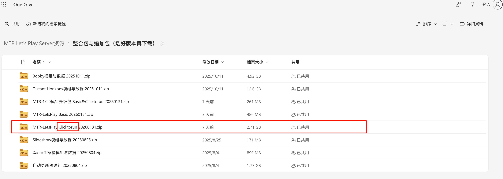

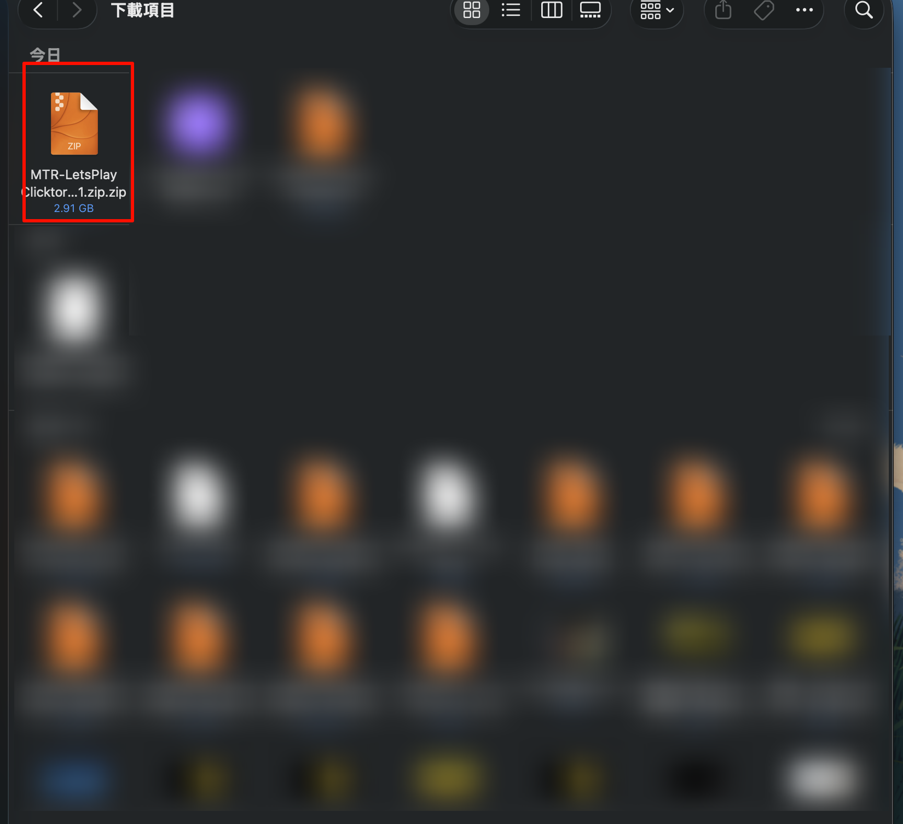

## 进服教程

### Part.1 安装 Java

如果您此前从未在电脑上运行过 Java 版 Minecraft，请从头开始阅读；如果您此前在电脑上安装过 Java 17 或以上版本，可以跳过本部分；如果您已经在使用第三方启动器（如 HMCL、PCL2、Prism Launcher 等），可以直接阅读 Part.3 安装整合包。

!!! tip "如何确认已安装 Java 17"

    在 Windows 上打开命令提示符（按 <kbd>Win</kbd>+<kbd>R</kbd> 打开运行框，输入 `cmd` 回车），或在 macOS 上打开终端，输入 `java -version`，如果出现版本号说明安装成功。如果您使用过网易版《我的世界》启动器游玩 Java 版 1.18 及以上版本，或使用的是官方启动器（不建议使用官方启动器安装整合包，步骤比较繁琐），则您很可能已经安装了 Java 17。

1. 下载 `［其他资源］` 文件夹内的 Java17 安装包，并双击运行（Adoptium Eclipse Temurin JDK 的界面会稍有不同，总体安装步骤类似）。如果您看到「您的计算机上已安装了此软件」的弹窗，说明您已经安装过 Java17，请点击<kbd>否</kbd>退出安装。

    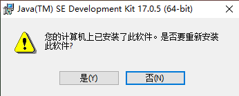

2. 如果一切正常，您将看到安装向导窗口，点击<kbd>下一步</kbd>即可。

    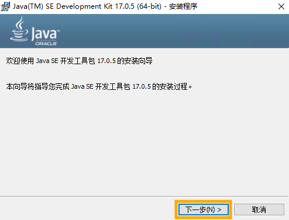

3. 若非必要，不建议更改 Java17 的安装路径，可能会导致启动器无法自动识别已经安装的 Java，保持默认即可，继续点击<kbd>下一步</kbd>。

    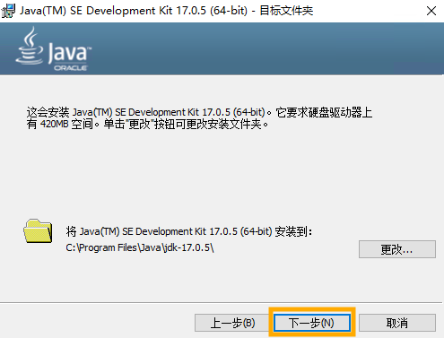

4. 等待进度条走完，您应该看到安装完成的画面，说明已经成功安装了 Java17，点击<kbd>关闭</kbd>以结束安装。

    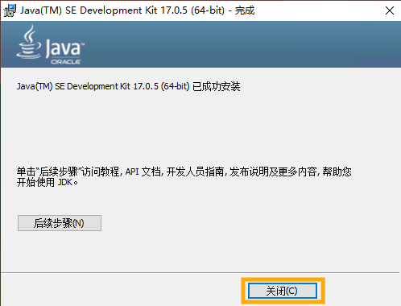

### Part.2 登录账号

以下以 HMCL 为例演示，PCL2 等其他启动器的操作类似。

1. 下载 `［其他资源］` 文件夹内的 HMCL 启动器。建议把启动器放在一个单独的文件夹中，这个文件夹将作为存储游戏数据的位置，请确保此文件夹所在的驱动器有足够空间，当然您也可以在以后随时移动此文件夹。

    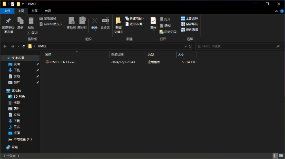

2. 双击打开启动器，点击左上角的<kbd>没有游戏账户，点击此处添加账户</kbd>。

    

3. 点击<kbd>微软账户</kbd>。

    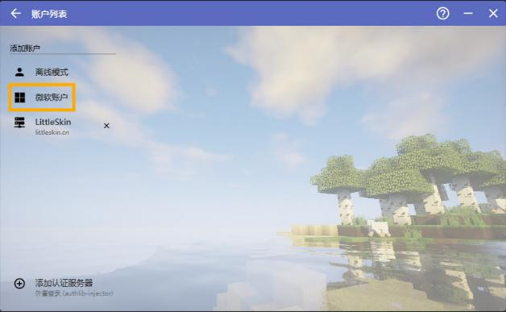

4. 点击<kbd>登录</kbd>，此时一串代码会自动复制到您的剪贴板，同时跳出一个浏览器窗口。

    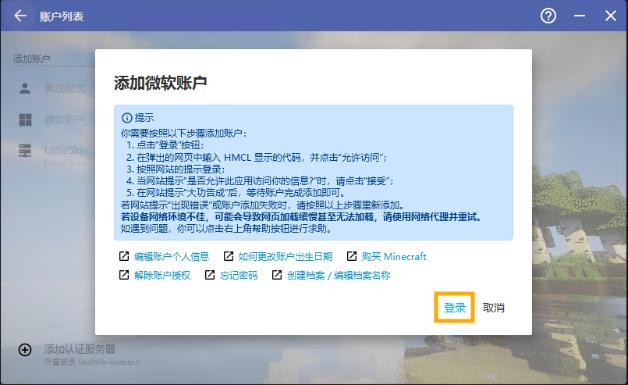

5. 将代码粘贴到输入框中，点击<kbd>允许访问</kbd>。

    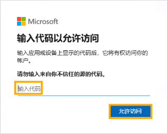

6. 如果浏览器内没有登录您的微软账号，请先登录。

    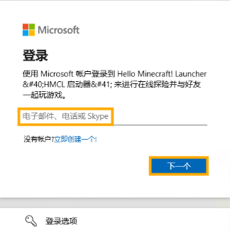

    登录完毕后，您应该看到「大功告成」的提示。

    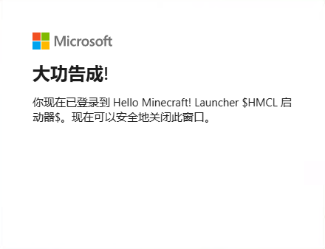

7. 如果一切正常，回到主界面后您应该看到您的头像与 ID 显示在「账户」一栏中。

    

### Part.3 安装整合包

!!! abstract "版本隔离设置"

    虽然整合包会强制开启版本隔离，但为了管理方便和避免出现不必要的麻烦，请先在全局设置里更改版本隔离设置为"各版本独立"。

    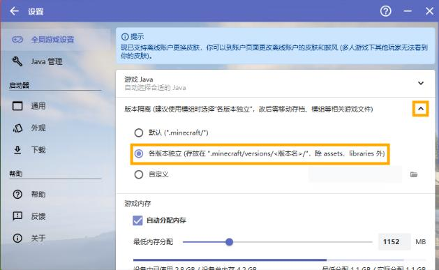

=== "Prism Launcher"

    打开 Prism Launcher，点击<kbd>添加实例</kbd>

    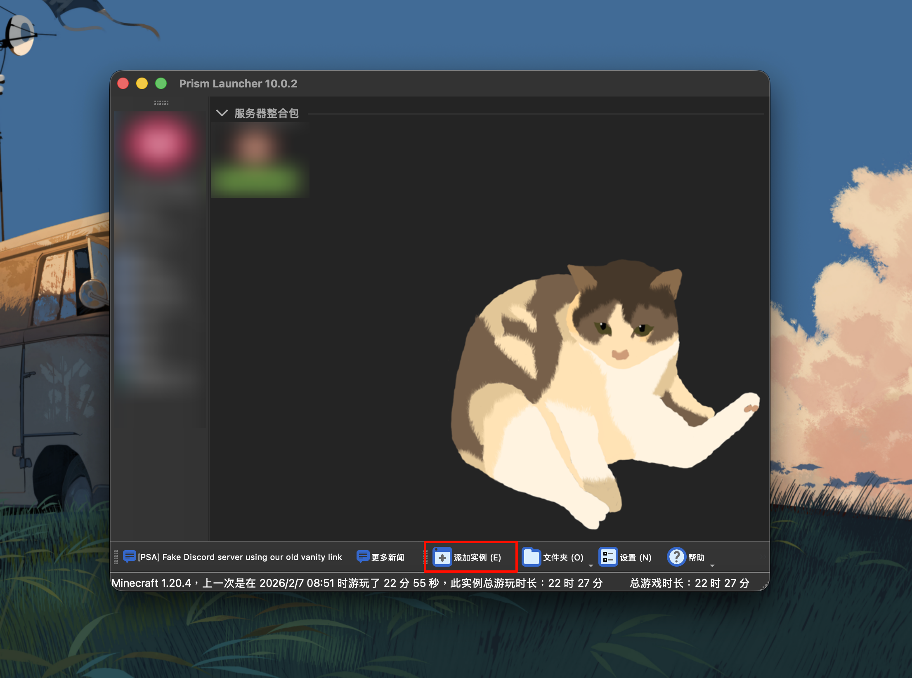

    依次点击<kbd>导入</kbd>→<kbd>浏览</kbd>

    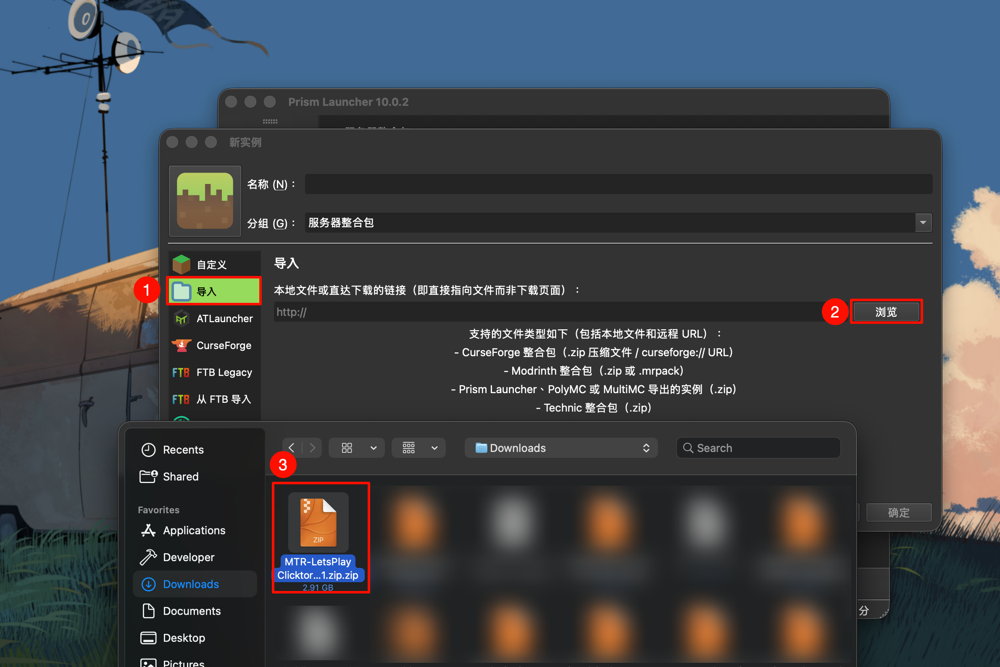

    选择您刚刚下载好的包导入，并点击<kbd>确定</kbd>进入下一步。

    稍等片刻，整合包将自动导入完成。

    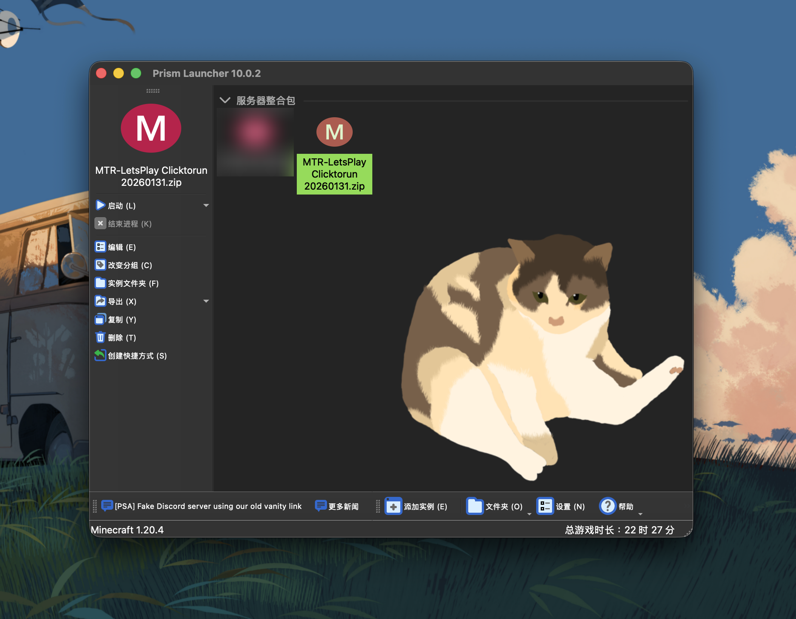

    如果 macOS 用户安装时遇到报错，请用压缩软件打开整合包，检查 `.minecraft` 文件夹内是否含有 `icon.png`。若有，请删去，然后重新尝试导入。

=== "HMCL"

    打开 HMCL，点击<kbd>实例列表</kbd>

    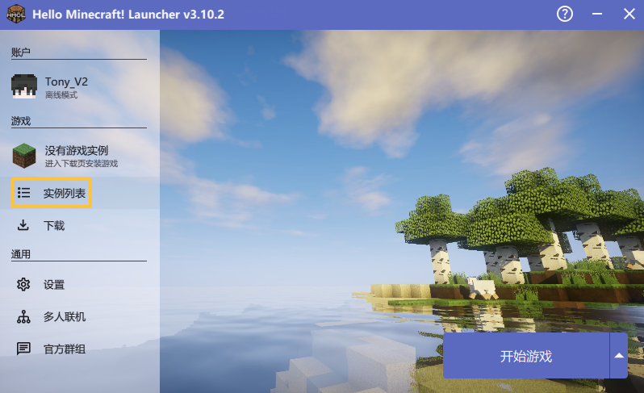

    点击<kbd>安装整合包</kbd>

    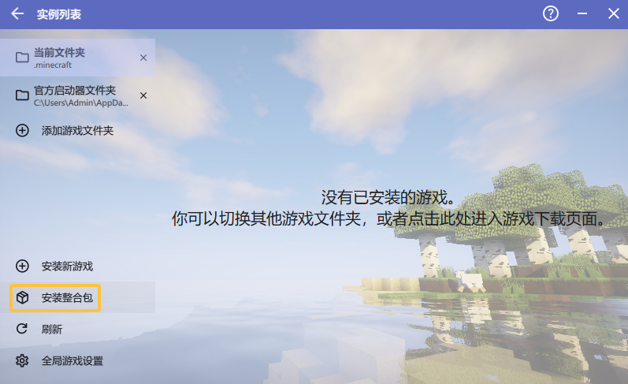

    点击<kbd>导入本地整合包文件</kbd>，选择刚刚下载好的包，点击<kbd>打开</kbd>

    或者直接将整合包文件拖入启动器窗口中

    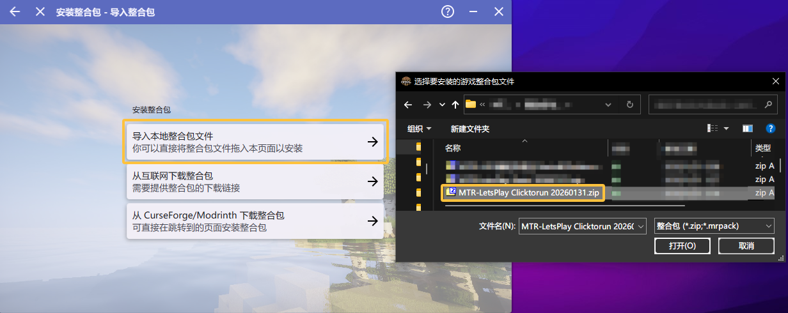

    在文件名一栏中，可以按个人喜好修改版本名称，这会影响启动器内该版本的显示名称与游戏版本文件夹的名称

    核对整合包信息无误后，点击<kbd>安装</kbd>

    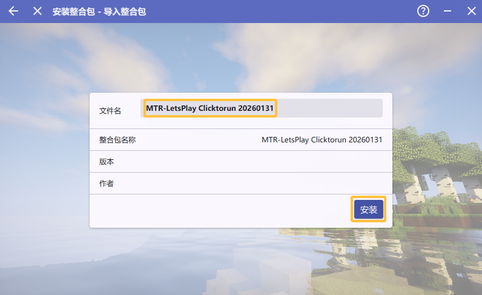

    整合包将自动下载所需的游戏文件并导入，这一步骤根据网络状况的不同，所消耗的时间也会略有不同。

    如果 MacOS 用户安装时遇到报错，请用压缩软件打开整合包，检查 `.minecraft` 文件夹内是否含有 `icon.png`，若有，请删去，然后重试导入。

    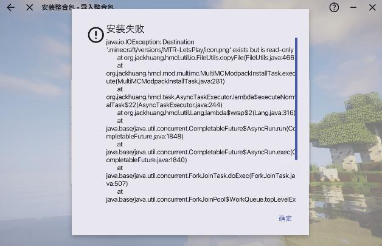

    如果一切正常，安装完成后您将看到「安装成功」的提示，点击<kbd>确定</kbd>

    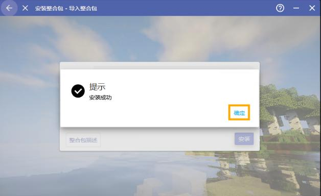

    导入完成后的整合包界面如下：

    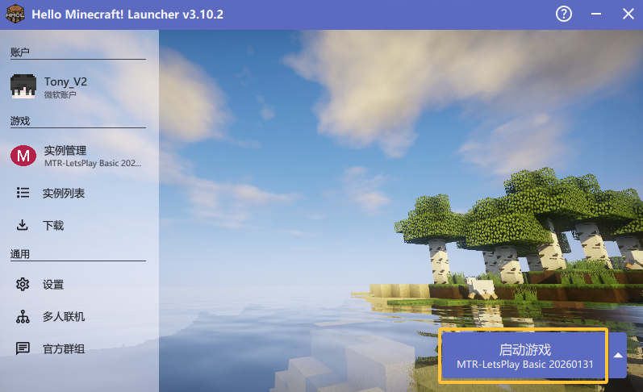

=== "PCL2"

    打开 PCL2，点击<kbd>版本选择</kbd>

    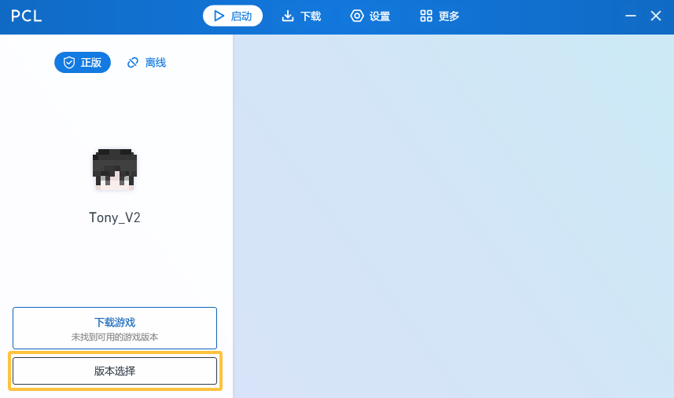

    点击<kbd>导入整合包</kbd>，选择刚刚下载好的包，点击<kbd>打开</kbd>

    或者直接将整合包文件拖入启动器窗口中

    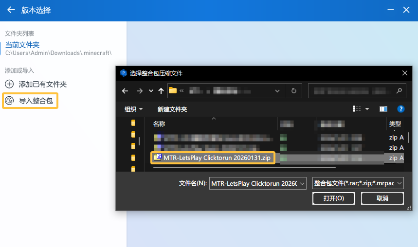

    按个人喜好填写版本名称，这会影响启动器内该版本的显示名称与游戏版本文件夹的名称

    填写完毕后点击<kbd>安装</kbd>

    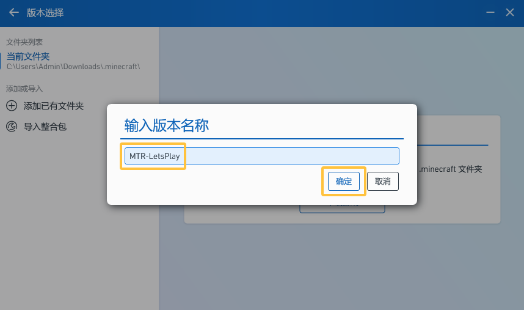

    稍等片刻，整合包将自动导入完成

    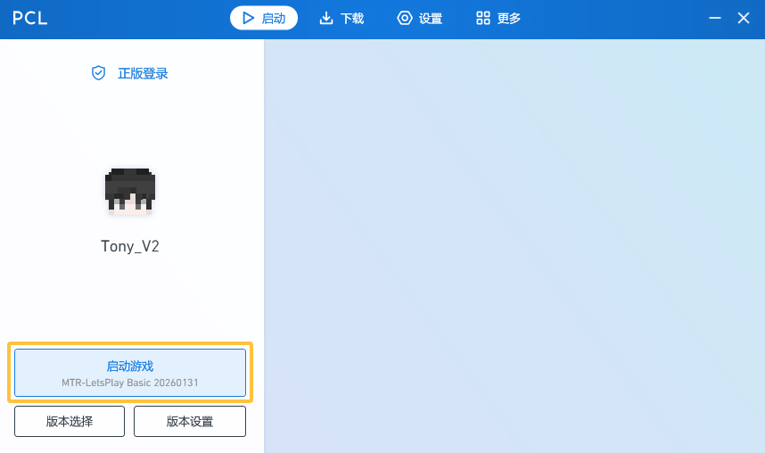

### Part.4 启动前设置

导入整合包后，回到主界面，点击对应版本的右侧三个点图标，点击<kbd>版本管理</kbd>，进入版本管理界面，根据电脑情况调整以下设置：

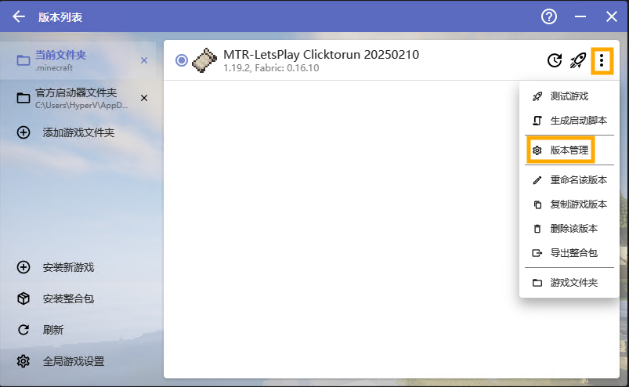

- **内存分配**：进入游戏至少需要 **4GB（4096MB）**（注意：分配的内存不能超出实际可用的物理内存的大小，否则会报错）
- **进程优先级**：可根据电脑配置适当调高，电脑配置低就调高一些
- **启动器可见性**：可根据个人喜好调整，保持启动器可见以方便游戏管理

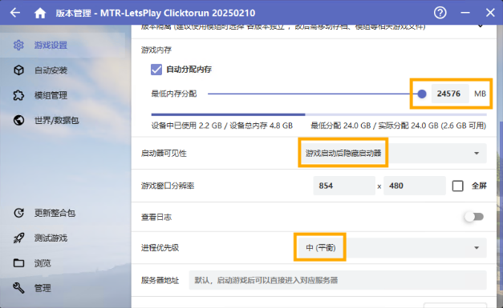

调整完毕后回到主界面，您已经完成了启动游戏前的所有操作。

!!! abstract "导入追加包"

    如果您下载了可选模组的追加包，请参阅[追加包导入教程](#part6)倒入。

### Part.5 启动游戏

点击启动游戏后，如果遇到「Could not create the Java Virtual Machine.」等 JVM 参数相关的弹窗，说明启动器导入整合包时对 JVM 参数头部的设置出现了问题，请参阅[问题 9](#9could-not-create-the-java-virtual-machine)。

如果一切正常，会加载出模组同步程序（Packwiz-installer），此时请不要操作，将会自动下载/更新所需模组。新版整合包一般只会出现情况 1。

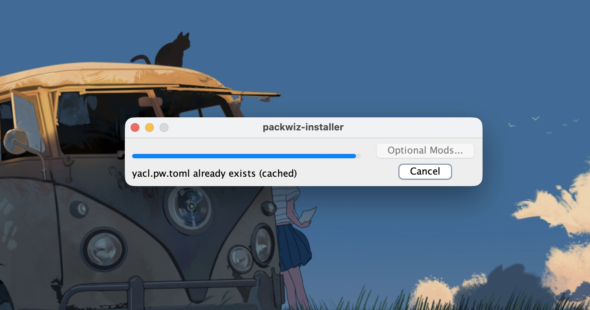

#### Packwiz-installer 模组自动更新

Packwiz-installer 用于模组的自动更新，此时根据网络情况的不同，会出现以下情况：

!!! success "情况 1：提示「重新配置可选模组」或显示「模组包已经是最新版本」"

    如果您想要检查更新（建议），点击「继续」或等待倒计时结束。如果您不想要检查更新（不建议，可能会导致客户端与服务端模组不匹配而无法进服），在继续的 10 秒倒计时结束前点击「取消」在弹出的窗口中点击「忽略」。

    如果您使用的是旧版整合包，且您的网络环境无法连接至 GitHub，可能会出现报错，点击「继续」，放弃自动更新即可。

!!! failure "情况 2：一直卡在「载入模组包文件」"

    点击「取消」，跳至情况 3。

!!! failure "情况 3：直接提示「HTTP 请求失败」"

    点击「在不更新的情况下继续」。

模组自动同步完毕后，将会弹出游戏窗口，此时资源同步实用程序（Resource Pack Updator Utility 模组，简称 RPU）会自动下载服务器所需资源包，请耐心等待。

!!! tip "首次进入：选择下载源"

    如果是第一次进入游戏，RPU 会要求选择下载源。推荐国内用户选择镜像源「Proxy (Aliyun Shanghai)」，速度最快（使用 <kbd>W</kbd> 键或方向上键选择上一个，<kbd>S</kbd> 键或方向下键选择下一个，<kbd>Enter</kbd> 键确认）。若之后感觉更新速度慢，也可以按 <kbd>Esc</kbd> 调出此界面换用其他源重试。

    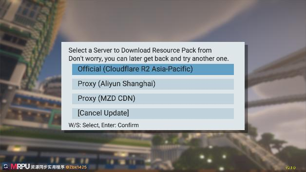

接下来 RPU 会先扫描本地资源包、检查本地资源包的元数据，并从服务器下载最新版本资源包的元数据进行核对；如果发现资源包不是最新版本，则会自动开始下载更新，更新速度因网络而异。

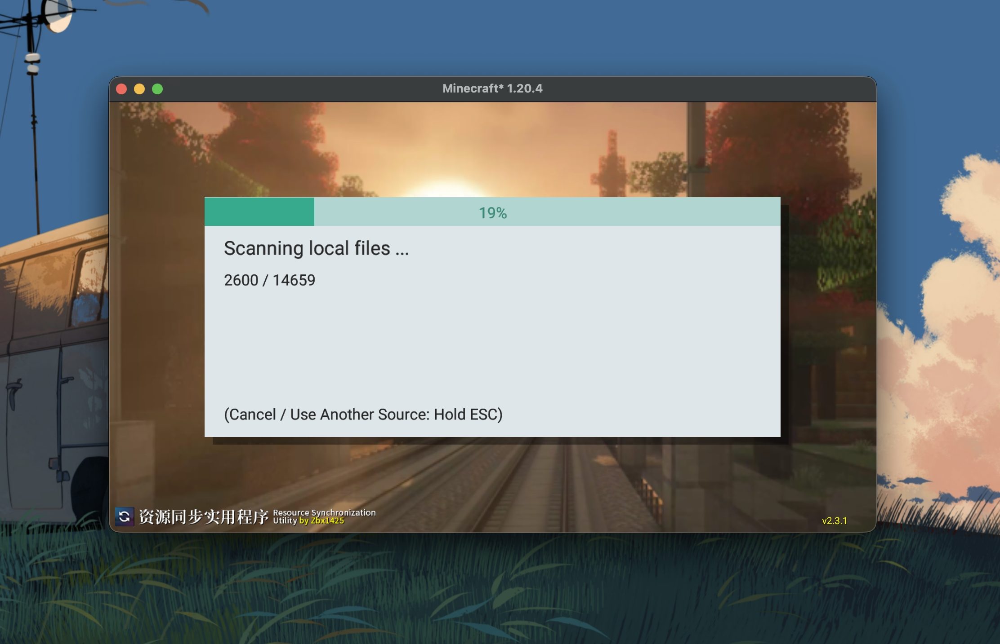

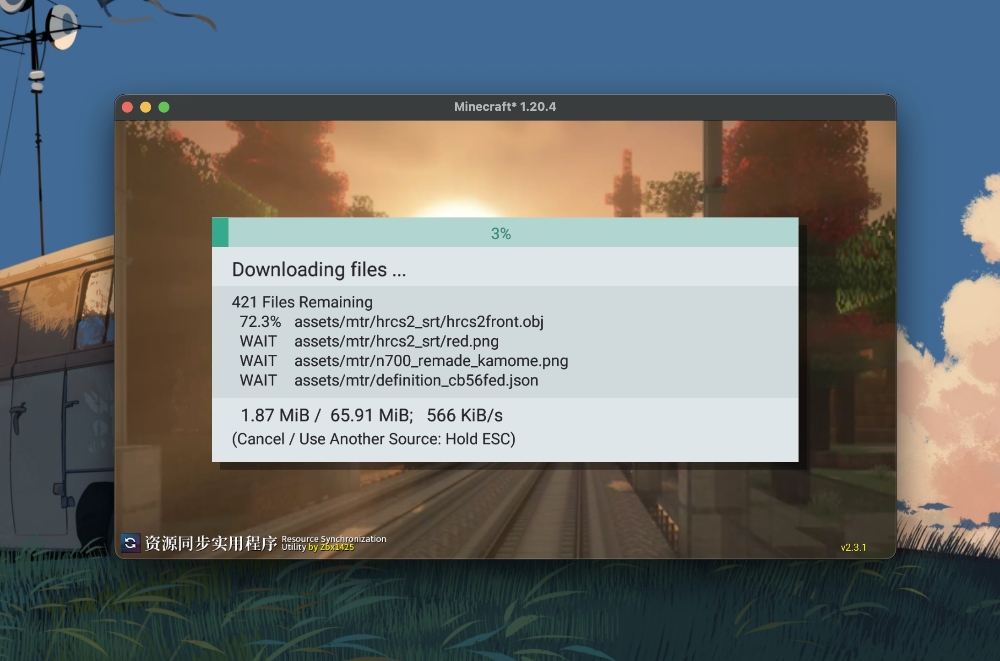

如果一切正常，您将看到「Done! Thank you.」的提示，说明资源包已经确认完整且可用。

!!! tip "资源包更新速度慢？"

    如果您感觉更新速度慢，可能是连接官方源速度较慢，请参阅[常见问题解答](#8)换用镜像源。

!!! tip "加载界面提示「未响应」？"

    如果您的电脑配置较低，此加载界面可能持续较长时间，并提示「未响应」，这是正常现象，请耐心等待，不要结束进程。服务器更新后这一等待时间已经大幅缩短；作为参考，使用 R9-7945HX 的笔记本电脑进入主界面的时间从之前的 1 分钟缩短到 15 秒。

完成之后您可能会看到如下界面且可能为英文，请按照下方图片操作：

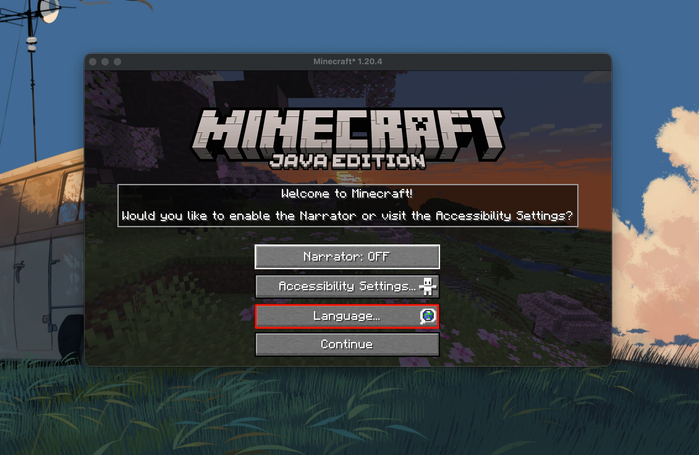

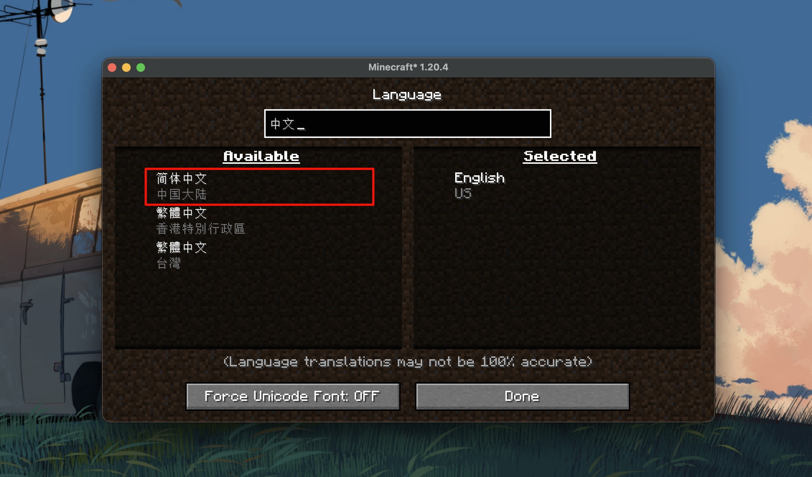

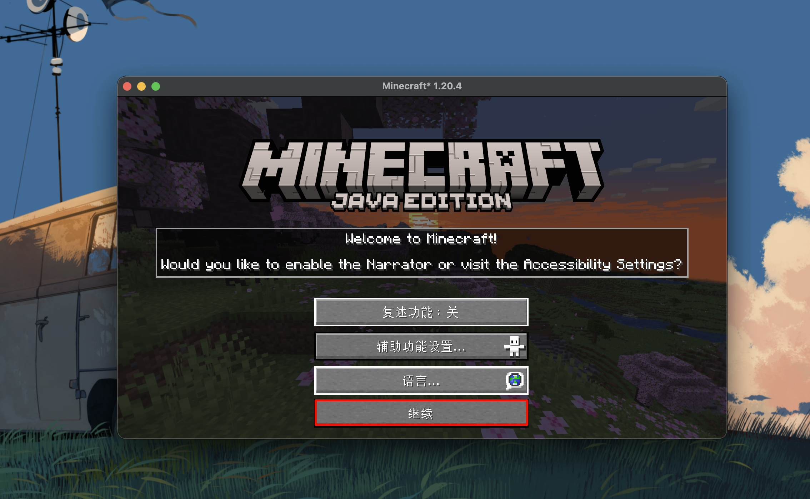

!!! warning "按键冲突提示"

    由于 Z 键是 MTR 模组默认的电梯选层按钮和 Xaero MiniMap 默认的小地图放大按钮，建议您进入游戏后先修改此冲突键位。

### Part.6 追加包导入教程

以 Bobby 模组与数据为例，下载后解压，选中全部的 3 个文件夹，直接拖入或复制/剪切至游戏版本根目录内（默认为启动器同级目录下 `.minecraft/versions/MTR-LetsPlay[整合包版本]`），您应该看到 `mods` 和 `config` 文件夹自动与根目录内已有的文件夹合并，如下图所示。

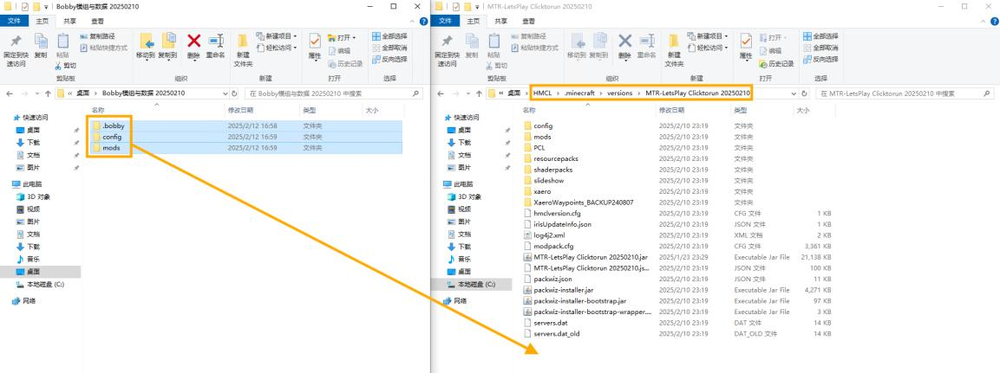

如果您已经安装过 Bobby 模组，只想要模组数据，直接复制 `.bobby` 文件夹至游戏版本根目录下即可（同理，DistantHorizons 模组复制 `Distant_Horizons_server_data` 文件夹，Slideshow 模组复制 `slideshow` 文件夹，Xaero 全家桶复制 `xaero` 文件夹）。

在再次启动游戏之前，建议您检查一遍 `mods` 文件夹内有没有对应的模组，根目录下有没有模组所需的数据，以防止出现启动问题。

!!! abstract "从旧版 Xaero 迁移"

    新版 Xaero 全家桶将两个模组的数据整合在了同一个文件夹中，而旧版则是分为 `XaeroWaypoints` 和 `XaeroWorldMap` 两个文件夹。如果您是旧版整合包用户，要使用追加包，请您把 `mods` 文件夹里的两个旧版本 Xaero 模组以及根目录下的 `XaeroWorldMap` 文件夹删除，再导入追加包。若您想要保留路径点，请暂时保留 `XaeroWaypoints` 文件夹，添加追加包后，删除 `xaero/minimap/Multiplayer_[服务器IP]` 内的所有文件，将原文件夹内的内容移动到这一文件夹，之后您可以删除旧的空 `XaeroWaypoints` 文件夹。

## 服务器IP

完成后点击多人游戏，请畅快开玩！

您可能会看到「在线游戏警告」，点击「确认」即可；此警告每次进入「多人游戏」界面都会出现，您也完全可以勾选「不再显示此屏幕」。

这里附上多人游戏内不同服务器选项所对应地址。如果内置的多人游戏服务器列表没有正确加载或意外丢失，请点击「添加服务器」或「直接进入」，手动将 IP 地址复制进去即可。

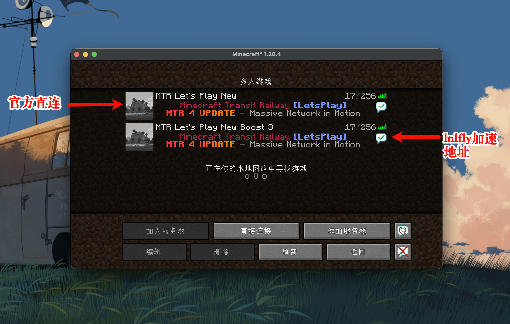

!!! tip "防火墙提示"

    对于第一次进入「多人游戏」界面的用户，您可能会遇到防火墙安全警报，建议您将「专用网络」和「公用网络」都勾选上，并点击「允许访问」，以避免网络连接问题。Windows 11 用户如果没有看到复选框，请点击「显示更多」。

### 官方IP

适用于海外玩家/北方移动，延迟可能较高。

- **IP 地址**：`letsplay.minecrafttransitrailway.com`
- **端口**：`25565`

#### 测试服IP

- **IP 地址**：`135.148.15.1`
- **端口**：`26888`

!!! info "关于测试服"

    服务器名称中带 New，是因为 2024 年 8 月末官服迁移到了位于德国的服务商，并更换为这一新 IP；旧 IP（`jonafanho.no-ip.org`，已弃用）在官服从 MTR 3.2 升级至 4.0 时被用作测试服，包含官服当时的一版地图备份以及另一个知名 MTR 服务器：岑城 Centown 的地图，现在仍然可以进入。

!!! info "历史加速 IP"

    加速 IP 1（`mtr.dexnt.com`，感谢 @dexnt 搭建）与加速 IP 2（`mtr.dovehub.top`，感谢 @dexnt 搭建）均已停用；加速 IP 3（`mc.lnlfly.com`，感谢 @MZDYHR 搭建）即当前使用的加速 IP。

### 加速IP

此连接地址由文档维护成员[@MZDYHR](https://github.com/MZDYHR)提供，适用于境内/中国香港地区链接。

- **IP 地址**：`mc.lnlfly.com`
- **端口**：`25565`

如果想要支持该加速地址的运营，请见[赞助](../about/sponsorship.md)

此连接地址由社区成员@Darkli提供，适用于南方/中国香港地区链接。

- **IP 地址**：`154.44.26.51`
- **端口**：`25565`

#### 测试服加速IP

此连接地址由文档维护成员[@MZDYHR](https://github.com/MZDYHR)提供，适用于境内/中国香港地区链接。

- **IP 地址**：`mtrtest.lnlfly.com`
- **端口**：`25565`

如果想要支持该加速地址的运营，请见[赞助](../about/sponsorship.md)

!!! tip "加速 IP 选择建议"

    一般情况下，中国大陆地区用户请选择加速 IP（`mc.lnlfly.com`）以获得更低延迟和更好体验。注意加速 IP 与加速器不要同时使用。

!!! tip "加速 IP 失效怎么办"

    若加速 IP 不可用，请到[社区服务监控](https://status.lpsguide.cn)查看「齐齐玩服务器 - lnlfly加速节点」下各节点的运行状态与延迟，选择状态正常（绿色）的节点 IP 替换即可。

## 更换 IP 时数据文件夹说明

!!! abstract

    如果您更换了使用的 IP（如从官服 IP 切换到加速 IP），部分模组的数据文件夹名称需要相应更改，否则模组将会无视已有数据而重新缓存，降低游戏体验的同时占用存储空间。

| 模组 | 数据文件夹 | 命名规则 | 示例（官服 IP） | 示例（加速 IP） |
| --- | --- | --- | --- | --- |
| **Bobby** | `.bobby/` | 以服务器 IP 命名 | `letsplay.minecrafttransitrailway.com` | `mc.lnlfly.com` |
| **Distant Horizons** | `Distant_Horizons_server_data/` | 以多人游戏服务器列表内的服务器名称命名 | `MTR+Let%27s+Play+New` | `MTR+Let%27s+Play+New+Boost+3` |
| **Xaero 系列**（旧版） | `xaero/minimap/` 和 `xaero/world-map/` | 以 `Multiplayer_[服务器IP]` 命名 | `Multiplayer_letsplay.minecrafttransitrailway.com` | `Multiplayer_mc.lnlfly.com` |

!!! tip "让 Bobby 不再需要手动改文件夹名"

    打开 `config/bobby.conf`，将 `dynamic-multi-world` 参数设为 `true`（默认为 `false`），然后进入服务器执行 `/bobby upgrade` 指令。这将会改变数据文件夹的调用行为，使所有多人游戏服务器共用同一份缓存数据，这份数据将会存储在已有的一个服务器的文件夹内（可以从缓存文件夹的大小看出），其他服务器的文件夹内则均为指向该数据的软链接。

    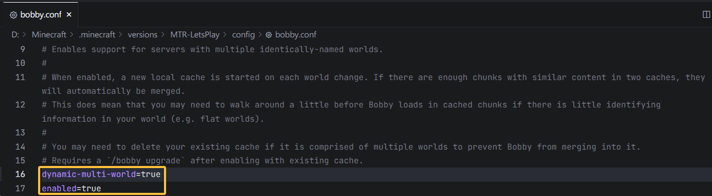

!!! info "新版 Xaero（20260212 及以后版本）"

    如果您使用的是 20260212 及以后版本的整合包，则更换 IP 时无需再更改 Xaero 系列数据文件夹的名称，因为配置文件中的 `differentiate_by_server_address` 参数将会使所有多人游戏服务器共用同一个数据文件夹（名称变为 `Multiplayer_Any Address`）。

!!! info "转义字符说明"

    Distant Horizons 的服务器名称中，空格为 `+` 号，撇号为 `%27`。如果您自行更改了多人游戏服务器列表内的服务器名称，请根据更改的名称对应修改数据文件夹名称；如果添加服务器时没有修改过服务器名称，默认应该是「Minecraft 服务器」。

## 整合包内文件说明

| 文件夹 | 说明 |
| --- | --- |
| `.bobby/` | Bobby 模组的区块缓存数据（若未安装 Bobby 模组则没有此文件夹） |
| `config/` | 模组配置文件（Clicktorun 版没有 Bobby 和 DistantHorizons 的配置文件，Standard 版没有 DistantHorizons 的配置文件） |
| `Distant_Horizons_server_data/` | DistantHorizons 模组的数据（Clicktorun 和 Standard 版没有此文件夹） |
| `mods/` | 模组文件 |
| `resourcepacks/` | 自动同步资源包（SyncedPack） |
| `shaderpacks/` | 光影包，其中有调教好的 Complementary Unbound 光影 |
| `slideshow/` | Slideshow 模组下载到本地的贴图文件 |
| `xaero/` | Xaero's Minimap 和 Xaero's World Map 的数据 |

`mods/` 文件夹内除整合包自带模组外，还包含以下增强游戏体验的模组：

- 高清截图 **Fabrishot**（按 `F9` 键可进行 4K 分辨率的截图，最大 8120×8120）
- 伽马工具 **Gamma-Utils**（按 `H` 开关夜视 Buff，按 `G` 调整伽马值，都能达到夜视效果）
- **SlideshowProxy**（由 @xingteh 开发，对存储在 GitHub 和 Imgur 上的 Slideshow 图片进行网络代理）
- 官方整合包中的可选模组也已经添加在其中，包括：连续性 **Continuity**（玻璃和书架等方块无缝连在一起，更美观）、自由相机 **Freecam**（按 `F4` 灵魂出窍）、星光 **Starlight**（重写优化光照引擎）、**Xaero 的小地图与世界地图**（路径点和大地图），以及缩放 **Zoomify**（`C` 键快速缩放，`F6` 二次缩放）等

## 常见问题解答

### 问题 1：经常丢失连接/无法移动或瞬移

这些都是网络延迟问题的表现，通常只有在使用官服 IP 连接时才会出现；网络条件与您的宽带条件、所在的区域与网络提供商都有关。

1. 换用[加速 IP](#ip_2)（最方便的方法）
2. 使用加速器的欧洲节点进行加速（效果因选用的加速器而异）
3. 换用手机移动数据热点连接（效果与所在区域以及运营商有关）

### 问题 2：进服后帧数很低

1. 确保您分配了尽量多的内存
2. 按 `Esc` 暂停，依次点击「选项」→「视频设置』
3. 向左拖动滑块，调低「渲染距离」、「最大阴影距离」、「模拟距离」三项参数
4. 点击「垂直同步」调至「关闭」
5. 向右拖动到底「最大帧率」滑块至「无限制」

### 问题 3：进服后区块加载慢

1. 确保您分配了尽量多的内存
2. 如果您没有安装 Bobby 模组，可以下载 Bobby 模组的追加包，能较大程度地缓解这一情况
3. 经过没有缓存过的区块时加载仍然较慢，更大的可能性是服务器本身的性能问题，无法避免
4. 如果是经过已经缓存过的区块时加载慢，应该是您的电脑配置较低，无法处理大规模的区块加载请求，请调低视野距离，方法与上述低帧率处理方法一致

### 问题 4：游戏启动时/进入世界时卡死

耐心等待即可，不要结束进程。

### 问题 5：进服后看不到 MTR 模组线路图和指示牌

可能是网络延迟过高的问题（见[问题 1](#1)）以及光影兼容性问题。关掉光影即可，在游戏内按 `O` 键可快速打开光影设置。

### 问题 6：Slideshow 模组的贴图显示为裂开的图片

出现此现象说明您的网络环境无法连接至这些图片所在的图床，属于正常现象，不影响游玩。如果您想要加载出贴图，请使用 VPN 进行尝试：打开 VPN 软件的全局+TUN 模式；或进入模组菜单中的 Slideshow 模组设置，启用「网络代理」，并将端口号设置为 VPN 软件的端口（例如 Clash 默认为 7890）。两种方法二选一即可。如果显示的是沙漏图标，说明图片正在加载，请耐心等待。

### 问题 7：加入服务器时提示「接收到 XX 个本客户端未知的注册表项」

这通常是由于您使用的 MTR 模组（及其附属模组）的版本与服务器的版本不匹配所导致的，说明模组自动更新程序没有正常工作，您需要手动将对应的模组更新至最新版本，才能正常进服。

**模组自动更新程序（Packwiz-installer）基本工作原理**：Packwiz-installer 将会访问存放着模组的 Git 仓库，并核对远端和本地的模组是否匹配，若不匹配则会自动下载需要更新的模组。

**手动更新方法**：

1. 前往存放模组的 Git 仓库下载需要更新的模组（推荐，最保险）
    - 官方仓库：`https://github.com/Minecraft-Transit-Railway/LetsPlay-Packwiz/tree/master/mods`
    - 镜像仓库（推荐）：`https://gitea.dusays.com/fenychn0206/LetsPlay-Packwiz/src/branch/master/mods`
2. 如果是 `.jar` 文件，可以直接下载，然后放到 `mods` 文件夹，并手动删除旧版本
3. 如果是 `.pw.toml` 文件，需要找到该模组的元数据文件内指定的 url，将链接复制到浏览器中打开即可下载
4. 也可以直接去 Modrinth（Curseforge 通常也可）平台上搜索并下载需要更新的模组的最新版本（有时此方法无效，因为官服内采用的模组可能是内测版，暂时没有上线模组分发平台，例如伦敦地铁 2.2.5 版本）

**模组类名与发布名称对照表**：

| 类名 | 发布名称 |
| --- | --- |
| `mtr` | [MTR] 我的世界铁路 Minecraft Transit Railway（MTR 模组本体） |
| `londonunderground` | [LU] 伦敦地铁 MTR London Underground Addon |
| `jsblock` | [JCM] 常磐装饰 Joban Client Mod |
| `msd` | [MSD] MTR 车站装饰 Station Decoration |
| `russianmetro` | [RMA] Russian Metro Addon（俄罗斯地铁追加） |
| `tjmetro` | 天津地铁 Tianjin Metro |

### 问题 8：资源同步实用程序界面报错/资源包更新速度慢

**现象 1：出现多次 Retry**。这是由于您的网络环境无法连接到官方的资源包更新服务器。

目前资源包有三个下载源：

| 下载源 | 说明 |
| --- | --- |
| Official (Cloudflare R2 Asia-Pacific) | 官方源，速度不快且连接可能受限 |
| Proxy (Aliyun Shanghai) | 镜像源，速度最快，建议使用 |
| Proxy (MZD CDN) | 镜像源，速度较慢，作为备份 |

您需要更换 RPU 的下载源为镜像源，有两种途径：

**方法一**：关闭游戏窗口，重新启动一次游戏。待 RPU 界面出现后，直接按 `Esc`，调出下载源选择界面（使用 `W` 键或方向上键选择上一个，`S` 键或方向下键选择下一个，`Enter` 键确认），选择「Proxy (Aliyun Shanghai)」将下载源切换为镜像源。

**方法二**：按 `Enter` 暂时禁用资源包，进入主界面，点击「模组」，进入模组菜单。在列表中找到「MRPU」，点击「配置」图标。点击 Source Servers 中的「Proxy (Aliyun Shanghai)」将下载源切换为镜像源，然后点击「Update & Reload」。

若仍然不行（小概率），使用 VPN 或手机移动网络热点重试。

**现象 2：出现「There is no source configured. Install the config file to your config folder!」**。这是由于在 RPU 从 2.3.1 升级到 3.1.0 版本的过程中，配置文件被丢失了。请自行在 `config` 文件夹中创建一个 `resourcepackupdater.json`，并参考[问题 12](#12-resource-pack-updator-utility)中的步骤填写配置文件。

**现象 3：出现「Odd number of characters.」**。请将 RPU 从 2.3.1 升级到 3.1.0 版本。

如果遇到上方没有提到的问题，可以试着多重启几次游戏，看 RPU 会不会自行修复问题。

!!! warning "关于禁用资源包"

    如果实在无法更新，您可以选择禁用资源包进服，但**非常不建议**。资源包内存储了服务器内绝大部分的列车模型与音效，现在服务器已经升级到了 MTR 4.0 版本，如果您没有资源包，将无法乘坐资源包内的所有列车，会对游戏体验产生很大影响。

### 问题 9：启动游戏时弹窗报错「Could not create the Java Virtual Machine.」

出现此问题是因为 JVM 参数头部的设置出现了问题，有可能是启动器在导入整合包时对参数进行了错误的转义，或是直接忽略了参数，导致启动时无法正确运行 Packwiz-installer 程序。

**JVM 参数头部原文**：

    ```java
    -javaagent:packwiz-installer-bootstrap-wrapper.jar=https://gitea.dusays.com/fenychn0206/LetsPlay-Packwiz/raw/branch/master/pack.toml
    ```

=== "HMCL"

    1. 点击「实例管理」
    2. 在「游戏设置」选项卡内下滑到底部，点击「编辑高级设置」
    3. 将 JVM 参数头部内所有内容删除，使用上方的参数头部原文替换

=== "PCL2"

    1. 点击「版本设置」
    2. 点击「设置」选项卡
    3. 展开「高级启动设置」
    4. 将 JVM 参数头部内所有内容删除，使用上方的参数头部原文替换

如果仍然报错，同时您认为您不需要 Packwiz-installer，请直接删除「JVM 参数头部」中的所有内容（**不建议**，禁用后自动更新将失效，容易导致[问题 7](#7-xx)而无法进服）。

### 问题 10：启动游戏时出现 Packwiz-installer 相关报错

出现这些报错，说明您的 Packwiz-installer 文件有缺失，请打开游戏版本根目录，确保以下三个文件均存在，缺少任意一个都会导致报错：

- `packwiz-installer.jar`
- `packwiz-installer-bootstrap.jar`
- `packwiz-installer-bootstrap-wrapper.jar`

您可以用压缩软件的文件管理器打开整合包，在 `.minecraft` 文件夹内找到这三个文件。

### 问题 11：如何禁用 Packwiz-installer / 不想要每次启动时都弹出自动更新窗口

**不建议禁用**，此程序负责模组的自动更新，以确保客户端与服务端的模组匹配；禁用后自动更新将失效，容易导致[问题 7](#7-xx)而无法进服。

如果您执意要禁用，按照[问题 9](#9could-not-create-the-java-virtual-machine)中的方法，删除 JVM 参数头部即可，删除后 Packwiz-installer 窗口启动时不会再出现。

### 问题 12：启动游戏时闪退并出现 Resource Pack Updator Utility 模组相关报错

此问题通常是由于游戏版本根目录下 `config` 文件夹中的 `resourcepackupdater.json` 被意外覆写或删除后还原至默认配置，同时您所在地区的网络防火墙拦截了资源包更新服务器的 IP 地址，导致 RPU 无法从官方源获取到资源包的元数据而报错，进而导致游戏闪退。查阅游戏日志 log 或崩溃报告，可以看到有关 `mc.zbx1425.cn` 访问受限的报错。根据 QQ 群友反映，中国大陆地区福建省与江苏省均有用户遇到过访问受限的情况。

**解决办法**：换用镜像源。用文本编辑器（如 Windows 记事本）打开 `resourcepackupdater.json`，将其中已有的内容删去，替换为以下内容：

    ```json
    {"version":2,"remoteConfigUrl":"https://gitea.dusays.com/fenychn0206/lps-community-guide/raw/branch/main/docs/assets/gameresources/client_config.json"}
    ```

接着启动游戏，应该自动进入下载源选择界面（使用 `W` 键或方向上键选择上一个，`S` 键或方向下键选择下一个，`Enter` 键确认），选择「Proxy (Aliyun Shanghai)」将下载源切换为镜像源。

**检验方法**：使用浏览器访问以下地址，如果能够加载出远端配置文件内容，说明可以获取对应下载源的资源包元数据，请启动游戏并选择能连接的下载源重试：

- 镜像源：`https://gitea.dusays.com/fenychn0206/lps-community-guide/raw/branch/main/docs/assets/gameresources/client_config.json`
- 官方源：`https://mc.zbx1425.cn/jlp-rp4/client_config.json`
- 官方源：`https://api.zbx1425.cn/mc/mtr-lp4/client_config.json`

### 问题 13：启动游戏时一直卡在红色 Mojang 读条界面

可能是游戏分配的内存过少所致，请确保最少分配了 **4GB（4096MB）** 内存给 MC 使用。如果可用内存不足，请尽量关闭其他无用程序，或使用虚拟内存。

### 问题 14：服务器内能建造吗

不能，所有 Visitor（参观者）默认为冒险模式。在服内建造需要成为 Builder（建造者），该职位实行邀请制，只能经由现任 Builder 推荐才有机会担任，而且目前 Builder 团队接近饱和，短期内没有招新计划。

如果想增加成为 Builder 的机会，需要在官方 Discord 上活跃，以吸引现任 Builder，并有一定的建筑水平与规划能力。

### 问题 15：加入服务器时提示「MRPU 版本不合」

参见[问题 7](#7-xx)的方法，更新 MRPU 模组。更新后，模组将自动升级资源包格式。

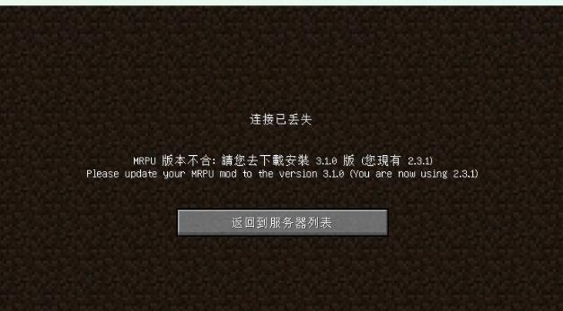

## 连接地址常见问题

### 加速 IP 和官方 IP 有什么区别？

- 官方 IP：服务器的官方地址，稳定性高，但延迟和丢包率也较高
- 加速 IP：经过优化的备用地址，可能提供更低的延迟。

### 我应该使用加速 IP 还是官方 IP？

- 如果官方 IP 连接正常且延迟可接受，可以继续使用官方 IP
- 如果官方 IP 延迟较高或不稳定，建议尝试加速 IP
- 可以将多个 IP 都添加到服务器列表，根据需要切换

### 加速 IP 无法连接怎么办？

1. 检查客户端版本是否匹配
2. 尝试其他加速 IP 节点
3. 使用官方 IP 连接
4. 检查网络连接

### 加速 IP 会定期更换吗？

- 加速 IP 地址通常保持稳定，不会频繁更换
- 如有变更，会在公告中通知

### 使用加速 IP 需要额外配置吗？

- 通常不需要额外配置，直接使用 IP 地址和端口即可
- 某些情况下可能需要配置代理，请参考相关教程

### 加速 IP 安全吗？

- 虽然加速 IP 由个人服务器提供，安全性没有保障，但这只是一个流量转发服务，盗不了你号，担心某些恶意 MOD 的攻击比这重要多了
- 同时，也请不要使用来源不明的 IP 地址，以防账号安全问题

## 服务器玩法

进入服务器后，您应该出生在世界原点；如果面前的图没有加载出来，不要被它吓到，这是 Slideshow 模组的正常现象，它没有碰撞体积，往前走即可。

出生点右侧上方有一个绿宝石贴图，这里是充值处，您在旅行之前需要先在这里充值您的「虚拟交通卡」。站在金色的压力板上会一直获得绿宝石，右键面前的充值机，点按任意面值的「充值」按钮即可；在充值机左上角可以查看现在的余额，建议多充值一点，防止之后坐车没钱（离开压力板会清除您身上的绿宝石）。

部分常用的快捷键：

| 按键 | 功能 |
| --- | --- |
| `Tab` | 查看服务器内的玩家，以及您的延迟、余额、服务端状态等信息 |
| `U` | 管理路径点 |
| `O` | 管理光影 |
| `H` | 开关夜视 |
| `C` | 缩放 |
| `F4` | 灵魂出窍 |
| `F9` | 进行 4K 分辨率的截图 |

您也可以自行去按键设置里查看其他快捷键。

服务器提供了 6 个 warp 传送点，从上到下分别是加平、云龙之门、丽湾、湖城、湾堡城和重生区，可以通过 `/warp` 指令来调用，按 `Tab` 键可以自动补全。

服务器有两个主要玩法：**MTR Quest** 和 **R2C**。

- **MTR Quest**：输入 `/nquest` 即可调起任务面板，从左到右三个功能分别是接取任务、查看排行榜、查看本人记录。任务列表与排行榜也可以在 [https://mc.zulubox.me/nquest](https://mc.zulubox.me/nquest) 查看，还可以使用 Discord 账号登录面板并绑定自己的 Minecraft 账号。做任务时建议打开服务器线路图和导航；注意看清任务的失败条件，例如不准 warp 和传送等，某些站的进站方式是命令方块传送也会导致任务失败。
- **R2C（Race to Cyan Heights）**：通过橙色门下面的压力板进入大厅，踩上绿色门下面的压力板开始游戏后，服务器会随机将您传送到一个地点，您需要在最短的时间内找到附近的车站，坐车回到重生区，并经过蓝色门下面的压力板。游戏会给到速度 4 和海豚的眷顾 4 的 Buff，以及 16 个末影珍珠，防止跑图过程中掉坑里出不来。游玩时建议打开服务器线路图和世界地图，导航可以不开，直接看线路图会更方便；如果使用了 `/warp Spawn` 则成绩直接作废。

一些实用提示：不在列车上时，所有的列车都没有碰撞体积，上车只要通过站台方块即可；如果您不小心落入轨道，且站台有屏蔽门，先别急着 `/warp`，在车门附近等待，等下一班列车停站开门时在车门处贴着站台方块跳跃一下，即可成功上车或登上站台；落入电梯井也是同理。此外，在模组菜单中打开 Freecam 设置，将「实用工具选项」-「允许交互」打开，即可按 `F4` 用自由视角穿出电梯门把电梯叫下来脱困。如果您不小心坐过站了，可以长按左 `Shift` 键强制下车，回到车站。
